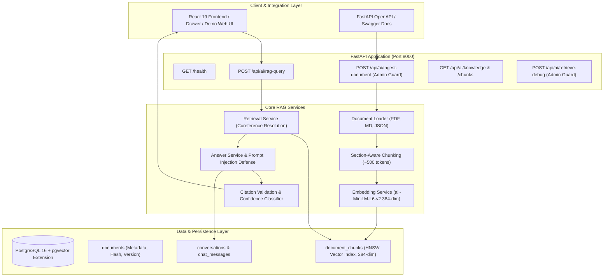

# ShopSmart AI — Module 2: RAG-Based Customer Knowledge Assistant

An enterprise-ready, independently runnable Retrieval-Augmented Generation (RAG) backend service for ShopSmart AI. This service ingests approved e-commerce business policies, indexes section-aware document chunks in PostgreSQL with pgvector, and generates strictly grounded customer answers with authentic source citations, confidence classification, and multi-turn conversation support.

---

## 1. System Architecture



---

## 2. Technology Selection Rationale

| Component | Selected Technology | Engineering Rationale |
| :--- | :--- | :--- |
| **Backend Framework** | **FastAPI + Uvicorn** | High-performance asynchronous REST API, native Pydantic v2 data validation, OpenAPI/Swagger auto-generation, and lightweight integration contract for Node.js / React consumers. |
| **Database & Vector Retrieval** | **PostgreSQL 16 + pgvector** | Unified relational and vector database. Avoids separate siloed vector databases, supports ACID transactions, foreign keys between documents and chunks, and HNSW cosine distance indexing (`<=>`). |
| **Embedding Model** | **`sentence-transformers/all-MiniLM-L6-v2` (384-dim)** | Industry-standard lightweight dense retrieval model running locally via FastEmbed ONNX runtime. Generates 384-dimensional normalized vectors with sub-10ms inference latency and zero GPU prerequisites. |
| **RAG & Orchestration** | **LangChain & Custom Grounded Engine** | Clean separation of loaders, text splitters, and model boundaries. Supports pluggable Google Gemini (`ChatGoogleGenerativeAI`) with strict deterministic grounding and prompt injection defenses. |
| **Document Processing** | **`pypdf` + Markdown/JSON Normalizers** | Robust multi-format parsing with scanned/empty PDF detection, section header extraction, and metadata preservation (versions, regions, effective dates). |

---

## 3. Directory Layout

```text
c:\Users\PANKAJ\OneDrive\Desktop\HCL Tech\
├── app/
│   ├── main.py                    # Application entrypoint & lifespan
│   ├── config.py                  # Pydantic BaseSettings configuration
│   ├── database.py                # Engine, session, and pgvector extension initialization
│   ├── schemas.py                 # Pydantic request, response, and citation schemas
│   ├── dependencies.py            # Authentication guards (X-API-Key / Bearer)
│   ├── api/
│   │   ├── health.py              # Health check endpoint (/health)
│   │   ├── query.py               # Policy RAG query endpoint (/api/ai/rag-query)
│   │   ├── ingestion.py           # Document upload endpoint (/api/ai/ingest-document)
│   │   └── knowledge.py           # Knowledge studio inspection & retrieval debug
│   ├── models/
│   │   ├── document.py            # Document entity (metadata, hash, status)
│   │   ├── chunk.py               # DocumentChunk entity with pgvector Vector(384)
│   │   ├── conversation.py        # Multi-turn conversation sessions
│   │   ├── message.py             # Chat messages with persistent citations
│   │   └── ingestion_job.py       # Ingestion audit and status tracking
│   ├── repositories/
│   │   ├── document_repository.py # Document CRUD, deduplication, superseding
│   │   ├── vector_repository.py   # pgvector cosine search with active filtering
│   │   └── conversation_repository.py # Multi-turn bounded history storage
│   ├── services/
│   │   ├── document_loader.py     # PDF, MD, and JSON parsers
│   │   ├── chunking_service.py    # Section-aware token chunker
│   │   ├── embedding_service.py   # 384-dim FastEmbed & local semantic engine
│   │   ├── ingestion_service.py   # Full ingestion pipeline orchestrator
│   │   ├── retrieval_service.py   # Query coreference resolution & retrieval
│   │   ├── answer_service.py      # Grounded answer synthesis & confidence
│   │   ├── citation_service.py    # Citation extraction & authenticity validation
│   │   └── rag_service.py         # End-to-end RAG facade
│   ├── prompts/
│   │   └── policy_assistant.py    # Grounded system prompt & template
│   └── utils/
│       └── logging.py             # Structured logging utility
├── data/
│   └── policies/                  # Fictional demo policy corpus
│       ├── returns.md             # Standard returns, opened laptop rules
│       ├── refunds.md             # Refund timelines & payment methods
│       ├── shipping.md            # Shipping SLAs, cancellation rules
│       ├── warranty.md            # 1-year smartphone warranty terms
│       └── membership.md          # ShopSmart Club / Prime delivery perks
├── migrations/
│   └── init_schema.sql            # PostgreSQL DDL & HNSW vector index
├── tests/
│   ├── conftest.py                # Isolated test DB fixture & sample seeding
│   ├── test_health.py             # Health probe tests
│   ├── test_ingestion.py          # Upload, PDF, JSON, duplicate & empty tests
│   ├── test_retrieval.py          # Similarity & filtering tests
│   ├── test_rag_query.py          # 12 RAG quality & scenario tests
│   ├── test_citations.py          # Citation authenticity tests
│   └── test_security.py           # Auth, prompt injection & SQL injection tests
├── scripts/
│   └── ingest_sample_policies.py  # Idempotent policy ingestion script
├── static/
│   └── index.html                 # Interactive demo UI & Knowledge Studio
├── .env.example                   # Environment configuration template
├── .gitignore                     # Git ignore rules
├── docker-compose.yml             # Local Docker Compose with pgvector:pg16
├── Dockerfile                     # Container image definition
├── requirements.txt               # Locked dependencies
├── README.md                      # Comprehensive documentation
└── pytest.ini                     # Pytest runner configuration
```

---

## 4. Setup and Quickstart

### Prerequisites
- Python 3.11+ or 3.12+
- Docker and Docker Compose (for PostgreSQL + pgvector)

### Option A: Running with Docker Compose (Recommended for Full Stack)
1. Start PostgreSQL with pgvector and the RAG service:
   ```bash
   docker compose up -d
   ```
2. Verify services:
   ```bash
   curl http://localhost:8000/health
   ```
3. Ingest the sample policies:
   ```bash
   docker compose exec shopsmart-rag python scripts/ingest_sample_policies.py
   ```
4. Access Swagger UI at `http://localhost:8000/docs` or the demo interface at `http://localhost:8000/demo`.

### Option B: Running Locally with Python
1. Clone the repository and enter the directory:
   ```bash
   cd "c:\Users\PANKAJ\OneDrive\Desktop\HCL Tech"
   ```
2. Install dependencies:
   ```bash
   pip install -r requirements.txt
   ```
3. Copy environment configuration:
   ```bash
   copy .env.example .env
   ```
4. Ingest sample policies:
   ```bash
   python scripts/ingest_sample_policies.py
   ```
5. Start the FastAPI server:
   ```bash
   uvicorn app.main:app --host 127.0.0.1 --port 8000 --reload
   ```
6. Open your browser:
   - **Interactive Web Demo**: [http://127.0.0.1:8000/demo](http://127.0.0.1:8000/demo)
   - **FastAPI Swagger Documentation**: [http://127.0.0.1:8000/docs](http://127.0.0.1:8000/docs)

---

## 5. REST API Contract & Examples

### 1. Health Probe
- **Endpoint**: `GET /health`
- **Response**:
```json
{
  "status": "ok",
  "service": "shopsmart-rag",
  "database": "connected",
  "embedding_provider": "fastembed",
  "embedding_model": "sentence-transformers/all-MiniLM-L6-v2",
  "llm_provider": "grounded_synthesis",
  "llm_model": "gemini-1.5-flash"
}
```

### 2. Ask a Policy Question
- **Endpoint**: `POST /api/ai/rag-query`
- **Request**:
```json
{
  "question": "Can I return an opened laptop?",
  "conversationId": "demo-session-001",
  "region": "IN",
  "category": "returns"
}
```
- **Response**:
```json
{
  "answer": "According to the ShopSmart Returns Policy (Section 2) [Chunk: 8f3c71...], an opened laptop or computing device may ONLY be returned if it has a verified hardware defect, is dead-on-arrival (DOA), or suffered verifiable transit damage reported within 7 days of delivery. Opened laptops cannot be returned for buyer's remorse, change of mind, or preference if the hardware is defect-free.",
  "confidence": "HIGH",
  "sources": [
    {
      "documentId": "a1b2c3d4-...",
      "document": "ShopSmart Standard Returns Policy",
      "section": "Section 2: Electronics and Computing Devices (Laptops)",
      "version": "2026.1",
      "effectiveDate": "2026-10-01",
      "region": "IN",
      "page": 1,
      "chunkId": "8f3c71..."
    }
  ],
  "followUpRequired": false,
  "followUpQuestion": null,
  "conversationId": "demo-session-001"
}
```

### 3. Unsupported Query (Honest Refusal & Zero Hallucinations)
- **Request**:
```json
{
  "question": "Can I trade my pet hamster for an international flight ticket?"
}
```
- **Response**:
```json
{
  "answer": "Based on our current approved ShopSmart policies, I do not have sufficient information to answer this question. ShopSmart policies do not contain rules regarding this topic.",
  "confidence": "LOW",
  "sources": [],
  "followUpRequired": false,
  "followUpQuestion": null,
  "conversationId": "demo-session-001"
}
```

### 4. Policy Document Ingestion (Protected)
- **Endpoint**: `POST /api/ai/ingest-document`
- **Headers**: `X-API-Key: shopsmart-admin-key-2026`
- **Form Data**:
  - `file`: `returns.md` (Multipart binary)
  - `category`: `returns`
  - `region`: `IN`
- **Response**:
```json
{
  "documentId": "4f18d721-...",
  "status": "indexed",
  "chunksCreated": 5,
  "embeddingModel": "sentence-transformers/all-MiniLM-L6-v2",
  "warnings": []
}
```

---

## 6. Security, Reliability & Quality Assurance

1. **Strict Evidence Grounding**: The assistant answers strictly from retrieved evidence and never extrapolates dates, fees, or warranties.
2. **Authentic Source Citations**: Every citation ID is verified against the actual chunks retrieved by the backend. Fabricated source IDs are rejected.
3. **Explicit Confidence Rules**:
   - `HIGH`: Direct applicable evidence with similarity >= 0.45 and verified citations.
   - `MEDIUM`: Partial support or minor regional ambiguity.
   - `LOW`: Insufficient evidence or unapproved topic (triggers honest refusal).
4. **Prompt Injection Resistance**: User queries are treated strictly as data; directives attempting to override policies or demand refunds are firmly rejected.
5. **Administrative Safeguards**: Document ingestion and developer debug endpoints require valid `X-API-Key` or Bearer tokens.
6. **Superseded Version Handling**: When a new policy version is ingested, prior versions are marked `superseded` so stale terms are not returned to customers.

---

## 7. Running the Automated Test Suite

Execute pytest across the 6 test modules:

```bash
pytest -v
```

Tests verify:
- Health check probe under normal and failure modes.
- Ingestion of PDF, Markdown, and JSON documents.
- Duplicate detection via content hash and version superseding.
- Empty/unscannable PDF error rejection.
- pgvector similarity search, category filters, and regional constraints.
- All 12 RAG evaluation scenarios (opened laptop, refund timelines, Prime free delivery, smartphone warranty, post-shipment cancellation, multi-turn follow-ups, and prompt injection defense).
- Citation authenticity mapping.
- Administrative authentication and SQL injection safety.
